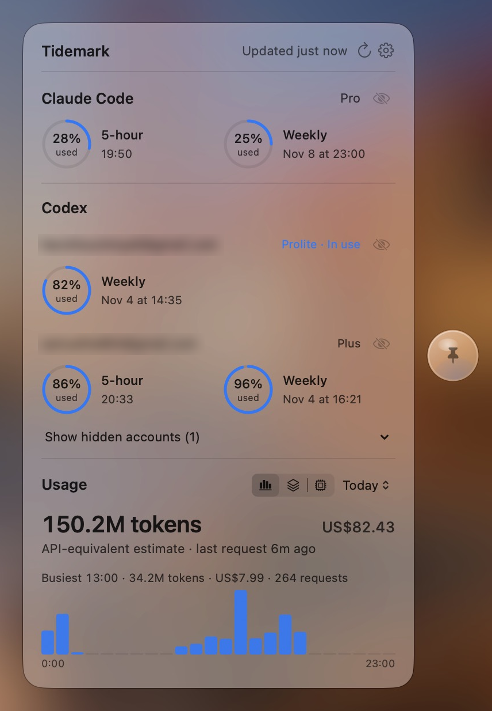

<div align="center">
  <h1>Tidemark</h1>

  <p>Claude Code and Codex quota, docked at the edge of your screen.</p>

  <p>
    
    
  </p>

  <p><a href="README.zh-CN.md">简体中文</a></p>

  
</div>

## Overview

Tidemark rests as a small glass tab on the edge of your screen. Hover to reveal an orb with a quota summary, click it to open the dashboard. It works on its own and is best alongside [CC Switch](https://github.com/farion1231/cc-switch).

<p align="center">
  
</p>

- Quota left and reset time for Claude Code and Codex, across every CC Switch Codex account.
- Token usage and estimated cost from CC Switch's history.
- Missing or stale data shows as unknown with its age, never as full.

## Install

Download the latest `.dmg` from [Releases](../../releases/latest) and drag Tidemark to Applications. Requires macOS 15 or later; macOS 26 gives you the Liquid Glass look.

## Use

- **Click** the orb to open or close the dashboard. **Option-click** or **right-click** pins it.
- **Drag** the orb to move it to another edge. If it goes missing, use **Show Companion** or **Reset Position** in the menu bar item.
- Open Settings with <kbd>⌘</kbd><kbd>,</kbd> to set a global shortcut, choose which accounts appear, and change how quota and resets are displayed.

## Data and privacy

Tidemark reads `~/.claude`, `~/.codex`, and `~/.cc-switch` and never changes them, with one exception below. By default it makes no network requests.

**Live Usage** (off by default) asks Claude and Codex for current quota using the sign-ins you already have. With it on, Tidemark may renew your CC Switch managed Codex accounts and save the rotated tokens back to `codex_oauth_auth.json`. Turn it off to use local readings only.

Usage history and extra Codex accounts need CC Switch. Quota for Claude Code and your active Codex account also works without it.

## Build

```sh
make build   # build the app
make run     # build and relaunch
make test    # run engine and data tests
make dmg     # signed, notarized DMG in build/release
make release VERSION=x.y.z   # build and publish a GitHub release
```

Release builds require Node.js 20 or later and `create-dmg` (`npm install --global create-dmg`).
The app is signed and notarized using the developer account signed in to Xcode.
Set `NOTARY_PROFILE` to a `notarytool` keychain profile to notarize and staple the DMG itself.

## License

MIT. See [LICENSE](LICENSE).
