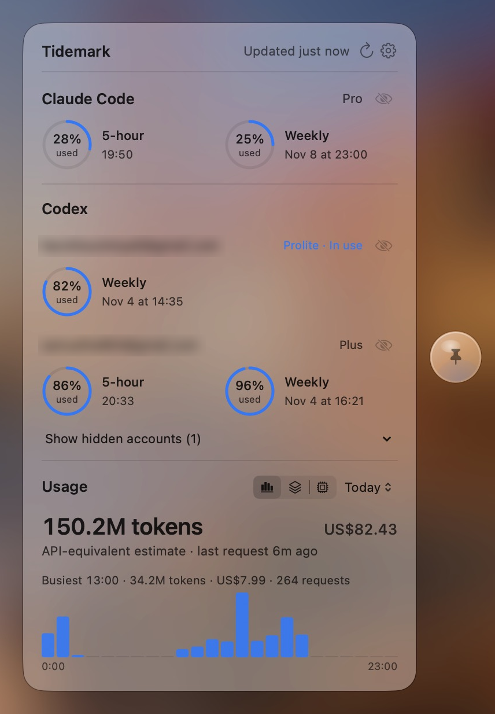

<div align="center">
  <h1>Tidemark</h1>

  <p>停靠在屏幕边缘，显示Claude Code和Codex额度。</p>

  <p>
    
    
  </p>

  <p><a href="README.md">English</a></p>

  
</div>

## 概览

Tidemark平时是屏幕边缘的一小块玻璃标签。鼠标悬停时浮现带额度摘要的球体，点击即可打开面板。可单独使用，搭配[CC Switch](https://github.com/farion1231/cc-switch)体验最佳。

<p align="center">
  
</p>

- 显示Claude Code和Codex的剩余额度与重置时间，涵盖CC Switch中的每个Codex账户。
- 显示来自CC Switch历史记录的token用量和估算费用。
- 缺失或过期的数据显示为未知并标注时间，绝不显示为满额。

## 安装

从[Releases](../../releases/latest)下载最新的`.dmg`，将Tidemark拖入“应用程序”。需要macOS 15或更高版本；macOS 26可获得Liquid Glass外观。

## 使用

- **点击**球体打开或关闭面板，**Option点击**或**右键点击**可固定面板。
- **拖动**球体可移到其他屏幕边缘。找不到时，可用菜单栏图标中的 **Show Companion** 或 **Reset Position**。
- 按<kbd>⌘</kbd><kbd>,</kbd>打开设置，可设置全局快捷键、选择显示哪些账户，并调整额度与重置时间的显示方式。

## 数据与隐私

Tidemark读取`~/.claude`、`~/.codex`和`~/.cc-switch`，除下述例外，不会修改它们。默认不发起任何网络请求。

**Live Usage**（默认关闭）会使用你已有的登录凭据，向Claude和Codex查询当前额度。开启后，Tidemark可能会续期CC Switch托管的Codex账户，并把轮换后的令牌写回`codex_oauth_auth.json`。关闭后仅使用本地读数。

使用历史和额外的Codex账户需要CC Switch。Claude Code和当前Codex账户的额度不依赖CC Switch。

## 构建

```sh
make build   # 构建应用
make run     # 构建并重新启动
make test    # 运行引擎和数据测试
make dmg     # 签名并公证的DMG，输出到build/release
make release VERSION=x.y.z   # 构建并发布GitHub release
```

发布版本使用Xcode中登录的开发者账户签名并公证。

## 许可证

MIT，详见[LICENSE](LICENSE)。
